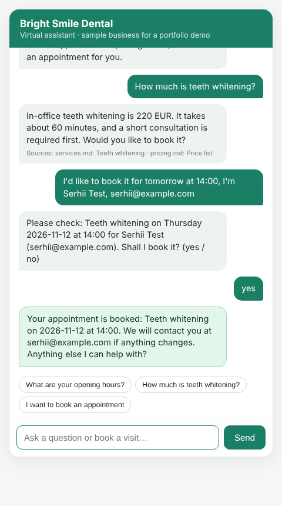
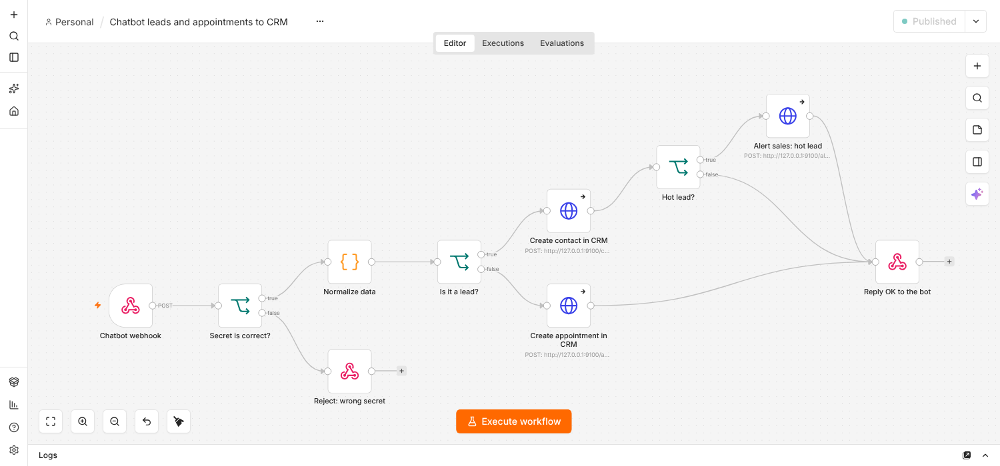

# RAG chatbot with lead capture and appointment booking

A website chatbot that answers questions **only from your own documents** (RAG), qualifies visitors,
collects their contact details, books appointments in a calendar and sends leads to a CRM.
Works with Claude or OpenAI, with automatic fallback to the other one if a provider is down.
Tested with live conversations on the real model: see [docs/live_test.md](docs/live_test.md).

The demo business is a fictional dental clinic ("Bright Smile Dental"). Replace the files in `knowledge/` with your own.



## What it does

| Feature | How it works |
| --- | --- |
| Answers from your FAQ, documents, prices | Markdown files in `knowledge/` are split into sections and searched with BM25. The best sections go into the prompt. If nothing matches, the bot says it does not know. |
| Updatable knowledge base | Edit or add `.md` files, then call `POST /admin/reindex`. No restart needed. |
| Lead qualification | The model finds out the needed service, asks one short question about timing when it is unknown, and politely collects name and email or phone, one thing at a time. It rates every lead **hot / warm / cold** with a one-sentence reason (hot: urgent problem or wants a date; warm: interested in a service or price; cold: general information). A confirmed booking is always hot (set by code, not by the model). Score and reason are stored with the lead, sent to the CRM, and the n8n workflow alerts sales about hot leads. Only services from a fixed list can be booked. |
| Appointment booking | Weekday opening hours, fixed slots, no double booking. If a slot is taken the bot offers free times. **The bot shows a summary with the weekday and books only after an explicit "yes".** |
| Any language | The question is rewritten into an English search query when needed, so Ukrainian, Slovak or any other language finds the English documents. Booking messages are translated for the visitor. |
| Handover to a human | If the bot cannot answer, the visitor's question is saved as a note together with their contact details in the CRM. |
| CRM | Leads are saved in SQLite. If `CRM_WEBHOOK_URL` is set (n8n, Make, Zapier, any API) every lead and appointment is also POSTed there, signed with a secret header, in the background, with retries. A ready n8n workflow is included. |
| LLM fallback | `LLM_PROVIDERS=anthropic,openai`: if Claude fails (timeout, rate limit, outage) the request goes to OpenAI. |
| Handover | Folder of code, 118 tests, a live test script with a real transcript, `.env.example`, this README. |

## How it is built

```
visitor ──> POST /chat ──> ChatAgent
                             1. BM25 search in knowledge/        (app/rag)
                             2. prompt + context + known data    (app/prompts.py)
                             3. LLM with fallback chain          (app/llm.py)
                                (query rewrite and translation use a small fast model)
                             4. validate extracted fields        (app/agent.py)
                             5. save lead / book slot            (app/crm.py, app/booking.py)
```

One design decision matters: **the model only talks and extracts data. Saving a lead or booking a slot is
done by normal code after validation.** The model cannot confirm a booking that does not exist, and a
wrong date or email is dropped and asked again. The day and time are checked (weekend, off the 30-minute grid, past,
too far ahead, already taken) **before** the visitor is asked to confirm, a short "yes" / "так" / "ano" is read by code in
any language, and moving or cancelling an appointment is always handed to the team, never turned into a new booking.

## Run it

```bash
python -m venv .venv && source .venv/bin/activate
pip install -r requirements.txt
cp .env.example .env          # add your API key(s); with no keys it runs in offline demo mode
uvicorn app.main:app --reload
```

Open http://localhost:8000.

Offline demo mode (no keys) uses a small rule-based `MockLLM`. It is only for demos and tests: its answers are
simple, and real models are much better at understanding free text.

## API

| Method and path | Purpose |
| --- | --- |
| `POST /chat` | `{"session_id": "abc", "message": "..."}` returns `reply`, `state`, `sources`, `booking`, `provider` |
| `GET /health` | status, number of indexed sections, LLM chain |
| `GET /admin/leads` | latest leads (needs `X-Admin-Token`) |
| `POST /admin/reindex` | reload `knowledge/` (needs `X-Admin-Token`) |

Admin endpoints are disabled until `ADMIN_TOKEN` is set. `/chat` is limited to 20 messages per minute per session.

## Connect a CRM (n8n workflow included)

The folder [`n8n/`](n8n/README.md) has a ready workflow: webhook, secret check, lead or appointment branch, CRM call, reply.
Import it into n8n, set a secret, replace the HTTP Request nodes with your CRM (Google Sheets, HubSpot, Pipedrive...) and put the
production URL into `.env`:

```
CRM_WEBHOOK_URL=https://your-n8n.example.com/webhook/chatbot-events
CRM_WEBHOOK_SECRET=your-long-random-string
```



Webhooks are sent in the background with 3 attempts, so a slow or broken CRM never delays the chat.
If all attempts fail, the lead stays in SQLite. Details and what was tested: [n8n/README.md](n8n/README.md).

## HubSpot and Google Calendar (optional, built in)

Two ready adapters, switched on by settings in `.env`. Without the settings the bot uses SQLite only.

**HubSpot (free CRM).** Create a *private app* in HubSpot, give it the scopes `crm.objects.contacts.read`/`write`
(and `crm.schemas.contacts.read`/`write` once, for the custom fields) and set `HUBSPOT_TOKEN=...`. Every lead becomes a
contact: found by e-mail (no duplicates), then updated by the stored HubSpot id. Besides name, e-mail and phone the bot
writes five custom properties: service, lead score, score reason, note, appointment.
`python -m scripts.check_integrations --create-properties` creates them. Without them the contact is still saved with the standard fields.

**Google Calendar.** Create a service account (Google Cloud, Calendar API enabled), share your calendar with its e-mail
with the permission *Make changes to events*, save the JSON key as `secrets/google-key.json` and set

```
GOOGLE_CALENDAR_ID=you@example.com
GOOGLE_SERVICE_ACCOUNT_FILE=/srv/chatbot/secrets/google-key.json
TIMEZONE=Europe/Bratislava
```

Busy times of that calendar are not offered to visitors (an event you add by hand blocks the slot), and every confirmed
booking becomes an event. SQLite still guards against double booking.

**If a service is down the chat keeps working.** HubSpot or Google errors are logged, the lead and the booking stay in
SQLite, `/health` shows `google_calendar_degraded`. Calls run with timeouts and retries (and in the background where the visitor would wait).

`python -m scripts.check_integrations --write-test` checks the token, the key file, the sharing and permissions, and
creates and removes one test contact and one test event, with a plain explanation of what to fix if something fails.

## Qdrant vector database (optional)

BM25 in memory is the default: no model, no API key, nothing to run. For a larger knowledge base you can keep the
index in [Qdrant](https://qdrant.tech) instead:

```bash
docker run -p 6333:6333 qdrant/qdrant                 # or Qdrant Cloud
RETRIEVER=qdrant QDRANT_URL=http://localhost:6333 uvicorn app.main:app
# no server? embedded mode, stored in a folder:  RETRIEVER=qdrant QDRANT_PATH=./qdrant_data
```

What it does: every section is stored as a **sparse vector** (BM25 word weights, finds exact words, names, numbers).
The collection is rebuilt on startup and on `POST /admin/reindex`.

### Meaning-based search (hybrid)

Add an embedding model and every section also gets a **dense vector**. Questions in other words then find the right
section ("how can I make my teeth lighter" finds *Teeth whitening*; "I have a terrible toothache" finds *Emergency care*).
The word results and the meaning results are merged with Reciprocal Rank Fusion.

```bash
pip install fastembed                                   # local model, no API key, ~130 MB download on first start
RETRIEVER=qdrant EMBEDDER=fastembed QDRANT_URL=http://localhost:6333 uvicorn app.main:app
# or the OpenAI embeddings API:  EMBEDDER=openai EMBEDDING_MODEL=text-embedding-3-small  (needs OPENAI_API_KEY)
```

`DENSE_MIN_SCORE` (default 0.6) decides how similar a section must be to count. It matters: too low and an off-topic
question ("do you sell used cars?") gets an unrelated section; too high and paraphrases are missed. The right value
depends on the model. Run `python scripts/eval_retrieval.py` with your model: it compares BM25 with hybrid on questions
written in different words and prints the highest off-topic and lowest on-topic score, so you can pick a value between them.

**If something fails the chat keeps working**: Qdrant unreachable at startup, the app logs an error and uses the
in-memory BM25 search. Qdrant dies while running, every search falls back to BM25 and Qdrant is skipped for 30 seconds
before the next try (`/health` shows `"search_degraded": true`). The embedding service is down at search time, only the
word search is used. Tested by killing a real Qdrant 1.20 server under a running app.

**What was tested.** Hybrid search runs against a real Qdrant server and embedded mode, with unit tests (fake embedder)
and a live Claude conversation. The GitHub Actions job `hybrid-search-eval` runs the real `BAAI/bge-small-en-v1.5` model
through `fastembed`: on 13 questions written in other words than the documents, **hybrid found 12, plain BM25 found 7**,
and all 3 off-topic questions correctly found nothing (`DENSE_MIN_SCORE=0.6`: highest off-topic cosine 0.58, lowest
correct match 0.64). The one miss is an idiom ("what will it set me back" meaning "how much does it cost").
The OpenAI embedder is written against the official SDK but was not run. Re-run `scripts/eval_retrieval.py` after changing
the model or the documents.

## Deploy on your own server (Docker + Caddy)

```bash
git clone https://github.com/niapard-commits/rag-chatbot-demo && cd rag-chatbot-demo
cp .env.example .env        # then edit .env: ANTHROPIC_API_KEY=..., ADMIN_TOKEN=a-long-random-string
docker compose up -d --build
curl localhost:8000/health
```

The container listens on `127.0.0.1:8000` only. For a public HTTPS address add a block to your Caddyfile
(Caddy gets the certificate by itself) and point a DNS record of `chat.example.com` to the server:

```
chat.example.com {
    reverse_proxy 127.0.0.1:8000
}
```

A public chat costs money with every message, so it has three protections (all in `.env`): `RATE_LIMIT_IP` (messages
per minute for one IP address, default 40), `DAILY_MESSAGE_CAP` (all messages per day, default 1000, then the chat says
to come back tomorrow) and the per-session limit. Also set a monthly spending limit for the API key in the provider's console.
Leads and bookings are kept in `./data` (survives updates). Optional Qdrant: `docker compose --profile qdrant up -d`.
`Dockerfile` and `docker-compose.yml` were written but **not built in the development sandbox** (no Docker daemon there); the app itself was run with uvicorn.

## Deploy (Render)

`render.yaml` is a Render Blueprint: *New > Blueprint*, pick the repository, type `ANTHROPIC_API_KEY` in the dashboard
(it is never stored in the repo). `ADMIN_TOKEN` is generated. The free plan sleeps when idle and its disk is wiped on
redeploy, so leads and bookings in SQLite are lost there: fine for a staging demo, use a persistent disk or PostgreSQL for real use.

## Tests

```bash
python -m pytest -q       # 198 tests, no network, no API keys
```

They cover retrieval, booking rules (double booking, weekends, opening hours, past times), the confirmation step,
lead saving, handover notes, translation and query rewriting, malformed model output, the LLM fallback chain and the HTTP API.
The HubSpot and Google Calendar adapters are tested against fake servers that behave like the real APIs (duplicates, missing fields,
retries, a deleted contact, a calendar not shared, services down), including the real service-account sign-in code with a throw-away key.

### Red-team run

`python scripts/live_redteam.py` runs 74 attack and edge-case conversations against the real model: see [docs/redteam.md](docs/redteam.md).

### Live test with the real model

```bash
ANTHROPIC_API_KEY=... python scripts/live_eval.py            # all scenarios
ANTHROPIC_API_KEY=... python scripts/live_eval.py faq handoff # chosen scenarios
RETRIEVER=qdrant QDRANT_URL=... ANTHROPIC_API_KEY=... python scripts/live_eval.py faq ukrainian   # with Qdrant
```

15 scripted conversations (questions, unknown topics, prompt injection, booking, taken slot, weekend, past date,
corrections, Ukrainian, Slovak, complaint). [docs/live_test.md](docs/live_test.md) has the full transcript and the list of
problems this test found that the mock-model tests had missed.

## Honest limits

- The Claude adapter was tested live (see `docs/live_test.md`). The OpenAI adapter is written against the official SDK
  but was **not run against the live API**: it is covered only by fake failing providers in the tests. Try it with your key before relying on the fallback.
- The Qdrant retriever was tested live with Claude (English and Ukrainian) on a Qdrant 1.20 server and in embedded mode. Dense search was verified with the fastembed model in CI; the OpenAI embedder was not run (see the Qdrant section).
- Replies take about 2 to 4 seconds. Answers are not streamed word by word.
- Chat sessions are kept in memory (lost on restart, one process). For several servers store them in Redis or the database.
- SQLite is fine for a demo and small business. For heavy traffic use PostgreSQL.
- The built-in calendar can be combined with Google Calendar (see above). Cancelling or moving a booking is not supported: the bot hands such requests to a human.
- The n8n workflow was tested with an HTTP stand-in for the CRM. The HubSpot and Google Calendar adapters were tested against fake servers; see docs/live_test.md for what has been run against the real services.
- No authentication of visitors, no payment, no spam protection beyond the per-session rate limit.
- All business data in `knowledge/` is made up.

## Project layout

```
app/        agent, llm, booking, crm, hubspot, gcal, prompts, api (main.py), rag/
knowledge/  your documents (markdown)
static/     the chat page
tests/      pytest tests
```

License: MIT.
