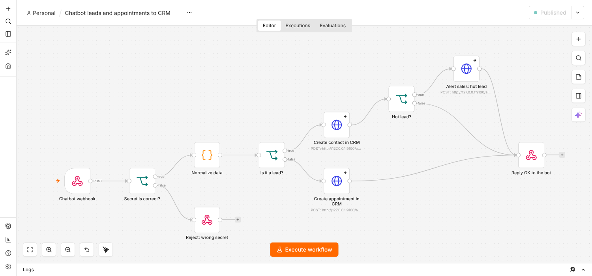
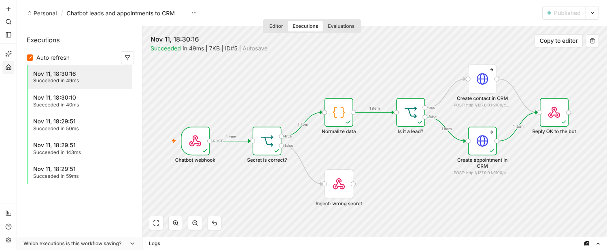

# n8n workflow: leads and appointments to your CRM

`chatbot-crm-workflow.json` receives every lead and appointment from the chatbot and passes it on to a CRM.



## What it does

1. **Chatbot webhook** receives `POST` events from the bot.
2. **Secret is correct?** compares the `X-Webhook-Secret` header with your secret. A wrong secret gets HTTP 401 and nothing else runs.
3. **Normalize data** turns the payload into one flat record: `event, session_id, name, email, phone, contact, service, note, score, score_reason, day, slot, received_at`.
4. **Is it a lead?** sends leads to **Create contact in CRM** and appointments to **Create appointment in CRM**.
5. **Hot lead?** After a contact is created, a lead the chatbot scored `hot` also goes to **Alert sales: hot lead** (a stand-in for a Slack or email message: "HOT LEAD: name (contact) - reason"). Warm and cold leads only create the contact. The bot sends the same lead again when its data changes, so in a real CRM or alert channel use `session_id` to avoid duplicates.
6. **Reply OK to the bot** returns `{"ok": true}`.

The two CRM nodes are plain HTTP Request nodes that post JSON to `http://127.0.0.1:9100/...`. That address is a stand-in for a real CRM API; replace those nodes with the one you use (see step 3).

## Set it up (about 5 minutes)

1. In n8n: **Workflows, menu, Import from file**, choose `chatbot-crm-workflow.json`.
2. Open the node **Secret is correct?** and replace `CHANGE_ME_SECRET` with your own long random string. Put the same string into the chatbot's `.env` as `CRM_WEBHOOK_SECRET`.
3. Replace the two **HTTP Request** nodes with your CRM node, for example **Google Sheets, Append row**, **HubSpot, Create contact**, **Pipedrive** or **Notion**. Map the fields from **Normalize data**. Tip: use `session_id` as the key, because the bot may send the same lead again with more details (for example after the visitor adds a phone number), and you want to update the row, not add a second one.
4. **Publish** the workflow. Copy the **Production URL** of the webhook node (not the "Test URL") into `.env` as `CRM_WEBHOOK_URL`. It looks like `https://your-n8n.example.com/webhook/chatbot-events`.
5. Test it without the bot:

```bash
curl -X POST https://your-n8n.example.com/webhook/chatbot-events \
  -H "Content-Type: application/json" -H "X-Webhook-Secret: YOUR_SECRET" \
  -d '{"event":"lead","session_id":"test1","name":"Anna Novak","email":"anna@example.com","service":"Check-up"}'
```

## Events sent by the bot

```json
{"event": "lead", "session_id": "...", "name": "...", "email": "...", "phone": null, "service": "Check-up", "note": null, "score": "hot", "score_reason": "Booked Check-up on 2026-11-16 at 10:00."}
{"event": "appointment", "session_id": "...", "name": "...", "contact": "...", "service": "Check-up", "day": "2026-11-16", "slot": "10:00"}
```

`note` holds the question the visitor wanted to pass to the team (for example "asks whether the clinic offers implants").

## What was tested

Tested on n8n 2.35.7 (self-hosted, local) with the real Claude model:

- a wrong secret is refused with 401 and creates no contact;
- a `hot` lead creates the contact and the alert, a `warm` lead only the contact (re-tested after lead scoring was added, with test events);
- a lead arrives at the contact endpoint and an appointment at the appointment endpoint, with the right fields;
- a full conversation (question, name and email, date, "yes") produced both events in n8n, see the executions below;
- if n8n is down, hangs or answers with an error, the visitor's reply is not delayed (it was 5 seconds before the webhook was moved to a background thread); delivery is tried 3 times, then logged, and the lead stays in the chatbot's own database.



**Not tested:** the Google Sheets, HubSpot and other real CRM nodes. They need your credentials, so only the HTTP stand-in was run. The field mapping in step 3 is therefore up to you to check with one test event.
